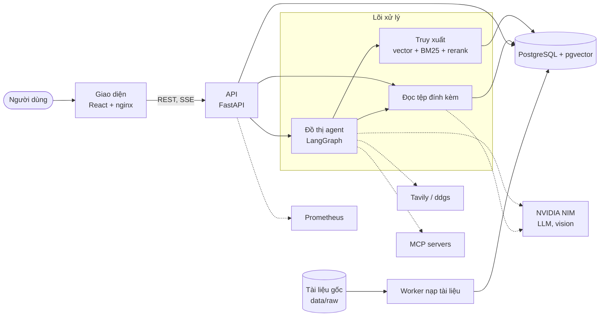
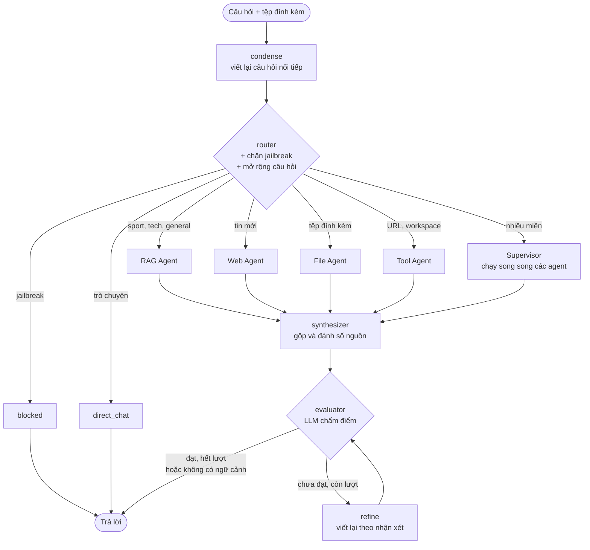

# Multi-RAG Agent

Trợ lý hỏi đáp dùng nhiều AI agent. Hệ thống tự chọn agent phù hợp cho từng câu hỏi, tra cứu trong kho tài liệu nội bộ, trên Internet hoặc trong tệp người dùng gửi, rồi trả lời kèm trích dẫn nguồn và tự kiểm tra câu trả lời.

**Mục lục:** [Tổng quan](#1-tổng-quan) · [Tech stack](#2-tech-stack) · [Kiến trúc](#3-kiến-trúc) · [Luồng xử lý một câu hỏi](#4-luồng-xử-lý-một-câu-hỏi) · [Vai trò từng thành phần](#5-vai-trò-từng-thành-phần) · [Cấu trúc thư mục](#6-cấu-trúc-thư-mục) · [Khởi chạy](#7-khởi-chạy) · [Mức độ kiểm chứng](#8-mức-độ-kiểm-chứng)

---

## 1. Tổng quan

| Khả năng | Mô tả |
| :-- | :-- |
| Hỏi đáp trên tài liệu nội bộ | Ba miền tri thức: `sport`, `tech`, `general`. Câu hỏi tiếng Việt tìm được cả tài liệu tiếng Anh và ngược lại |
| Tìm kiếm Internet | Tin tức, tỷ số, thông tin mới; có đọc nội dung trang kết quả |
| Đọc tệp người dùng gửi | PDF (kể cả bản scan), ảnh, Word, Excel, PowerPoint, văn bản, mã nguồn |
| Dùng công cụ ngoài | Đọc tệp trong workspace và mở URL qua Model Context Protocol (MCP) |
| Câu hỏi nhiều miền | Nhiều agent chạy song song, câu trả lời được gộp lại |
| Tự kiểm tra | Một LLM chấm câu trả lời; chưa đạt thì viết lại trước khi trả về |
| Nhớ hội thoại | Hiểu câu hỏi nối tiếp, lưu lịch sử, stream câu trả lời, dừng giữa chừng |

---

## 2. Tech stack

| Lớp | Công nghệ |
| :-- | :-- |
| Giao diện | React 19, Vite 7, react-markdown; nginx khi triển khai |
| API | FastAPI, Uvicorn, Pydantic, Server-Sent Events |
| Điều phối agent | LangGraph, LangChain Core |
| LLM | NVIDIA NIM: `nemotron-3.5-lightning-30b` (trả lời, chấm điểm), `nemotron-3.5-bolt-e4b` (định tuyến, việc nhỏ), `nemotron-3.5-super-vl-120b` (đọc ảnh) |
| Embedding và rerank | `BAAI/bge-m3`, `BAAI/bge-reranker-v2-m3`, chạy bằng ONNX Runtime int8 |
| Truy xuất | pgvector (HNSW) hoặc Chroma, BM25, Reciprocal Rank Fusion |
| Cơ sở dữ liệu | PostgreSQL (production) hoặc SQLite (dev), SQLAlchemy, Alembic |
| Đọc tệp | pypdf, pypdfium2, docx2txt, openpyxl, python-pptx, Pillow, lxml |
| Tìm kiếm web | Tavily, dự phòng `ddgs` |
| Công cụ ngoài | MCP (server `filesystem`, `fetch`) |
| Giám sát | Prometheus |
| Đánh giá, kiểm thử | LLM judge, pytest |
| Triển khai | Docker Compose, GitHub Actions |

---

## 3. Kiến trúc



Nét liền là luồng bên trong hệ thống, nét đứt là dịch vụ ngoài hoặc tùy chọn.

---

## 4. Luồng xử lý một câu hỏi



- Riêng RAG Agent có dự phòng ba tầng: miền được chọn, các miền còn lại, rồi Internet.
- Trong lúc xử lý, API gửi sự kiện SSE để giao diện hiển thị tiến trình và bản nháp. Câu trả lời chính thức nằm trong sự kiện `final`. Chi tiết ở [api/README.md](api/README.md).

---

## 5. Vai trò từng thành phần

### Agent

| Agent | Vai trò | Mã nguồn |
| :-- | :-- | :-- |
| Router | Phân loại câu hỏi, chọn một hoặc nhiều agent. Câu chào được nhận ra bằng regex, không gọi LLM | [router_agent.py](src/agents/router_agent.py) |
| RAG (sport, tech, general) | Tìm trong kho tài liệu của miền và trả lời có trích dẫn | [rag_agent.py](src/agents/rag_agent.py) |
| Web | Viết lại câu tìm kiếm, tra Internet, tổng hợp | [web_agent.py](src/agents/web_agent.py) |
| File | Trả lời từ tệp người dùng gửi | [file_agent.py](src/agents/file_agent.py) |
| Tool | Gọi công cụ MCP theo vòng lặp | [tool_agent.py](src/agents/tool_agent.py) |
| Supervisor | Chạy song song nhiều agent | [supervisor_agent.py](src/agents/supervisor_agent.py) |
| Synthesizer | Gộp câu trả lời, đánh lại số nguồn | [synthesizer_agent.py](src/agents/synthesizer_agent.py) |
| Judge và Refiner | Chấm điểm và viết lại câu trả lời | [judge.py](src/evaluation/judge.py) |

### Dịch vụ khi triển khai

| Dịch vụ | Vai trò |
| :-- | :-- |
| `web` | Phục vụ giao diện ở cổng 8080, chuyển `/api` tới API |
| `api` | Nhận câu hỏi, chạy đồ thị agent, đọc tệp đính kèm, quản lý hội thoại |
| `worker` | Nạp tài liệu vào kho vector, theo dõi thay đổi trong `data/raw` |
| `postgres` | Lưu hội thoại, tệp đính kèm, hàng đợi và vector |
| `migrate` | Cập nhật schema rồi thoát |
| `prometheus` (profile `monitoring`) | Thu thập số liệu |

---

## 6. Cấu trúc thư mục

Mỗi thư mục có README riêng mô tả từng file và cách hoạt động.

| Thư mục | Nội dung |
| :-- | :-- |
| [api/](api/README.md) | HTTP API: hỏi đáp, tệp đính kèm, tài liệu |
| [src/](src/README.md) | Mã nguồn lõi |
| [frontend/](frontend/README.md) | Giao diện chat |
| [config/](config/README.md) | Cấu hình và biến môi trường |
| [alembic/](alembic/README.md) | Migration cơ sở dữ liệu |
| [scripts/](scripts/README.md) | Xuất mô hình ONNX và script hỗ trợ |
| [evals/](evals/README.md) | Bộ câu hỏi đánh giá và kết quả |
| [tests/](tests/README.md) | Kiểm thử tự động |
| [deploy/](deploy/README.md) | Cấu hình giám sát và hướng dẫn triển khai |
| [docker/](docker/README.md) | Entrypoint của container |
| [data/](data/README.md) | Tài liệu gốc, mô hình, dữ liệu lúc chạy |

---

## 7. Khởi chạy

Cần [NVIDIA API key](https://build.nvidia.com). Nên có thêm [Tavily key](https://app.tavily.com) để tìm kiếm web ổn định.

### Cách 1: Docker Compose (đầy đủ)

```bash
cp .env.example .env               # điền NVIDIA_API_KEY, POSTGRES_PASSWORD, JWT_SECRET, ADMIN_TOKEN
pip install -r requirements.txt
python scripts/export_onnx.py      # một lần, tạo data/models/onnx
docker compose up -d --build       # http://localhost:8080
```

Nếu `.env` đặt `WEB_DIST=prebuilt`, hãy chạy `npm install && npm run build` trong `frontend/` **xong rồi mới** chạy Docker. Chi tiết triển khai: [deploy/README.md](deploy/README.md).

### Cách 2: Chạy trực tiếp (dev)

```powershell
python -m venv .venv
.venv\Scripts\Activate.ps1         # Linux/macOS: source .venv/bin/activate
pip install -r requirements.txt
copy .env.example .env             # điền NVIDIA_API_KEY
uvicorn api.main:app --port 8000   # tài liệu API: http://localhost:8000/docs
```

```powershell
cd frontend
npm install
npm run dev                        # http://localhost:5173
```

Chế độ này dùng SQLite và Chroma, không cần Docker. Đặt tài liệu vào `data/raw/<miền>/` để hệ thống tự nạp.

### Kiểm thử

```bash
python -m pytest -q                 # toàn bộ, cần mô hình và kho tech đã nạp
python -m pytest -q -m "not models" # không cần mô hình, giống CI
```

---

## 8. Mức độ kiểm chứng

Các mục 1–5 chỉ mô tả chức năng **đang bật và đã chạy thật** (25/11/2026, LLM thật, image Docker hiện tại). Riêng MCP được kiểm trên máy dev, vì trong Docker MCP bị tắt. Kiểm thử tự động: 217 đạt, 2 bỏ qua.

### Có mã nguồn nhưng chưa dùng được trong sản phẩm

| Phần | Tình trạng |
| :-- | :-- |
| Đăng nhập, JWT, phân quyền | Dùng được khi đặt `AUTH_ENABLED=true` (mặc định tắt). Trình duyệt đạt 40/40, backend 61/61; còn vài hạn chế: [src/auth](src/auth/README.md#vấn-đề-chưa-sửa) |
| Kiểm duyệt bằng NemoGuard | Đang bật nhưng **không hoạt động**: model quá hạn ở mọi lần gọi, kể cả khi chờ 60 giây. Chỉ lớp chặn jailbreak theo mẫu câu còn tác dụng |
| Google Sign-In, Langfuse | Chưa cấu hình, chưa chạy với dịch vụ thật |
| Tài liệu và mô hình trên S3, MinIO | Chỉ có test với S3 giả lập |
| Grafana | Chưa chạy được ở đây (không tải được image) |
| RAGAS, ngữ cảnh trang, HyDE, PyTorch | Không bật hoặc chưa kiểm lại |

### Hạn chế đã biết

- Kho `general` trống; bộ đánh giá chỉ có 24 câu.
- MCP tắt trong Docker vì image không có `npx`, `uvx`.
- Câu hỏi nối tiếp được hiểu đúng chủ đề, nhưng câu trả lời "giải thích kỹ hơn" có thể lặp lại câu trước.
- Chưa thử: chữ viết tay, ảnh chụp mờ, dán ảnh từ clipboard, nút Dừng trên giao diện (API dừng đã thử).
- Quản lý tài liệu chỉ qua API. Chưa có sao lưu tự động.
