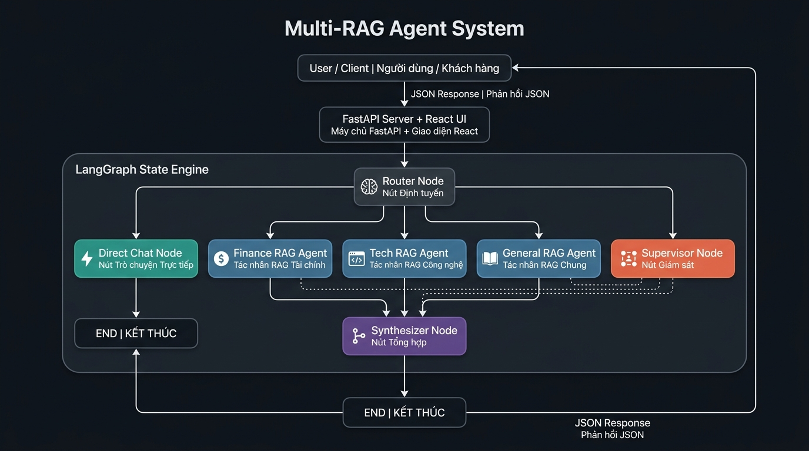
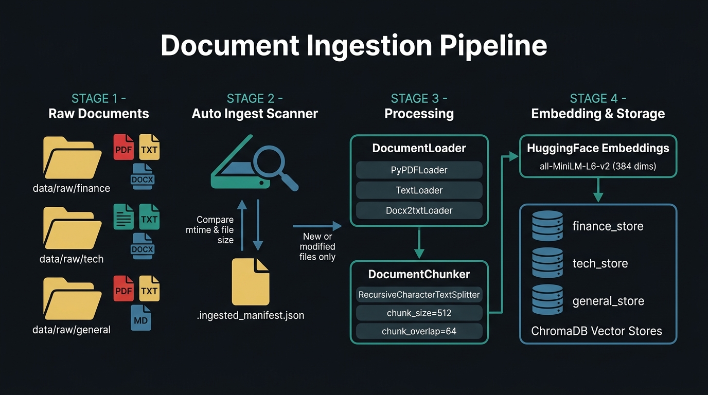
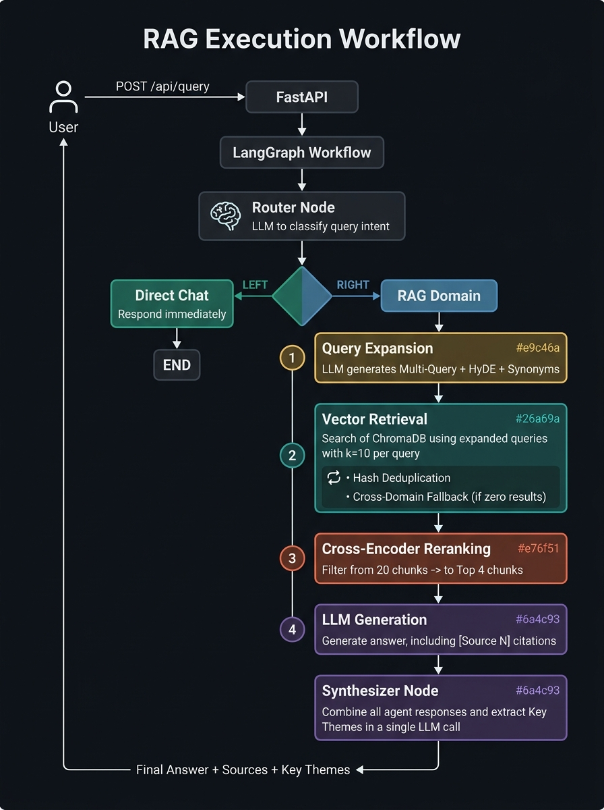
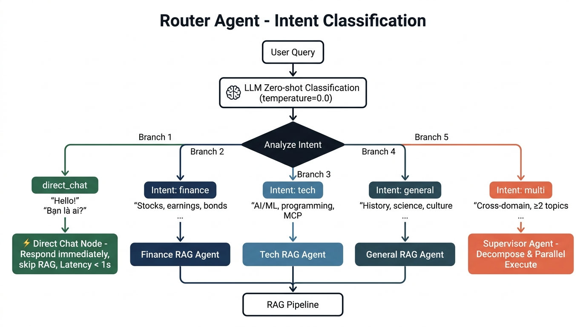
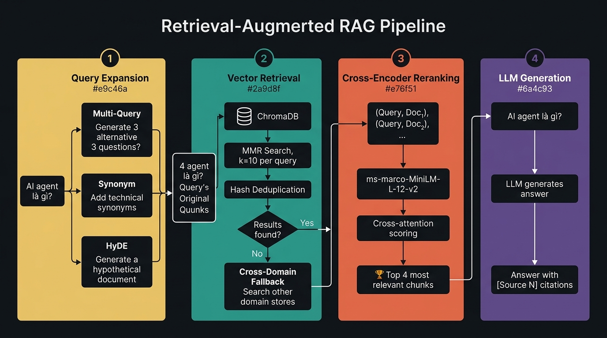
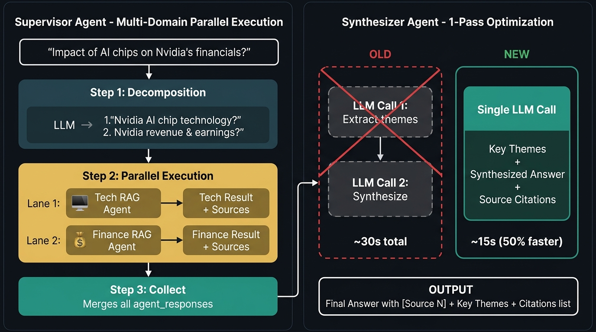

# Hệ Thống Multi-RAG Agent (Multi-Agent Retrieval-Augmented Generation)

> Hệ thống Multi-RAG Agent thông minh điều phối nhiều Agent chuyên biệt theo từng miền tri thức (*Finance*, *Tech*, *General*), kết hợp **LangGraph**, **Chroma Vector Store**, **Hybrid Retrieval (Vector + BM25)**, **Cross-Encoder Reranker**, và **LLMs (NVIDIA NIM)** để giải quyết các truy vấn phức tạp với độ chính xác và khả năng trích dẫn nguồn cao.

---

## 📑 Mục lục
1. [Tổng Quan Kiến Trúc (Architecture Overview)](#1-tổng-quan-kiến-trúc-architecture-overview)
2. [Chi Tiết Pipeline Xử Lý Dữ Liệu (Ingestion Pipeline)](#2-chi-tiết-pipeline-xử-lý-dữ-liệu-ingestion-pipeline)
3. [Luồng Hoạt Động Của Hệ Thống RAG (RAG Execution Workflow)](#3-luồng-hoạt-động-của-hệ-thống-rag-rag-execution-workflow)
4. [Bên Trong Từng Thành Phần RAG (Internal RAG Mechanics)](#4-bên-trong-từng-thành-phần-rag-internal-rag-mechanics)
   - [Router Agent & Direct Chat Routing](#41-router-agent--direct-chat-routing)
   - [Cơ Chế Nội Bộ Pipeline RAG (Expansion, Retrieval, Reranking)](#42-cơ-chế-nội-bộ-của-pipeline-rag-retrieval-augmented-generation-pipeline)
   - [Supervisor Agent & Synthesizer Agent (Đa tác tử & Tối ưu hóa)](#43-supervisor-agent--synthesizer-agent-phối-hợp-đa-miền--tối-ưu-hóa)
   - [Web Search Tool & Live Internet Agent (Thông tin thời gian thực)](#44-web-search-tool--live-internet-agent-thông-tin-thời-gian-thực)
5. [Cấu Trúc Thư Mục Dự Án](#5-cấu-trúc-thư-mục-dự-án)
6. [Cấu Hình Hệ Thống (Configuration)](#6-cấu-hình-hệ-thống-configuration)
7. [Hướng Dẫn Cài Đặt & Khởi Chạy](#7-hướng-dẫn-cài-đặt--khởi-chạy)
8. [API Endpoints & Cách Sử Dụng](#8-api-endpoints--cách-sử-dụng)

---

## 1. Tổng Quan Kiến Trúc (Architecture Overview)

Hệ thống được thiết kế theo mô hình **Multi-Agent Directed Acyclic Graph (DAG)** xây dựng trên nền tảng **LangGraph**. Thay vì sử dụng một kho vector store đơn lẻ khổng lồ dễ gây nhiễu, hệ thống phân tách tri thức thành các miền độc lập (*Finance*, *Tech*, *General*).



---

## 2. Chi Tiết Pipeline Xử Lý Dữ Liệu (Ingestion Pipeline)

Quy trình nạp tài liệu biến đổi dữ liệu thô (PDF, DOCX, TXT, Markdown) thành các vector embedding và lưu trữ vào ChromaDB theo từng domain.



### Các bước xử lý trong Ingestion:
1. **Quét tự động (Auto-Scan & Incremental Delta Check):** Khi khởi động server FastAPI (`lifespan`), `src/ingestion/auto_ingest.py` tự động quét các thư mục `data/raw/{domain}`.
2. **Theo dõi Manifest (`.ingested_manifest.json`):** Lưu trữ đường dẫn, thời gian sửa đổi (`mtime`) và kích thước (`size`) của từng file. Nếu file chưa từng nạp hoặc đã bị chỉnh sửa, hệ thống mới tiến hành nạp, giúp tránh trùng lặp dữ liệu và tiết kiệm thời gian khởi động.
3. **Phân rã văn bản (Chunking):** Sử dụng `RecursiveCharacterTextSplitter` với:
   - `chunk_size = 512`: Độ dài tối ưu ngữ nghĩa cho các mô hình embedding dạng nhỏ/nhanh.
   - `chunk_overlap = 64` (hoặc `128`): Giữ tính liên tục của ngữ cảnh giữa các đoạn cắt liền kề.
   - `add_start_index = True`: Lưu vị trí index để phục vụ việc trích xuất toạ độ dữ liệu.
4. **Vector Embedding:** Sử dụng mô hình `BAAI/bge-m3` (đa ngôn ngữ, dimension = 1024, vector chuẩn hóa) qua HuggingFace để mã hóa nội dung chunk thành vector không gian.
5. **ChromaDB Multi-Collection:** Mỗi domain sở hữu một thư mục lưu trữ độc lập:
   - Finance: `data/vectorstores/finance_store` (collection: `finance_collection`)
   - Tech: `data/vectorstores/tech_store` (collection: `tech_collection`)
   - General: `data/vectorstores/general_store` (collection: `general_collection`)

---

## 3. Luồng Hoạt Động Của Hệ Thống RAG (RAG Execution Workflow)

Mỗi khi người dùng gửi một câu hỏi qua API `/api/query`, luồng xử lý diễn ra chi tiết qua các giai đoạn:



---

## 4. Bên Trong Từng Thành Phần RAG (Internal RAG Mechanics)

### 4.1. Router Agent & Direct Chat Routing



**Output JSON mẫu của Router:**
```json
{
  "route": "tech",
  "primary_domain": "tech",
  "all_domains": ["tech"],
  "domain_scores": {"tech": 0.95, "finance": 0.0, "general": 0.05, "direct_chat": 0.0},
  "confidence": 0.95,
  "reasoning": "Câu hỏi hỏi về kiến trúc Microservices và REST API"
}
```

### 4.2. Cơ Chế Nội Bộ Của Pipeline RAG (Retrieval-Augmented Generation Pipeline)



Quy trình RAG bao gồm 4 giai đoạn nối tiếp nhau được tinh chỉnh để tối đa hoá độ chính xác:
1. **Query Expansion (Mở rộng câu hỏi):**
   - **Multi-Query:** LLM sinh thêm 2 biến thể câu hỏi (mặc định chỉ bật Multi-Query) tiếp cận từ nhiều góc độ khác nhau.
   - **Synonym Expansion (có sẵn, mặc định tắt để giảm số lần gọi LLM):** Bổ sung thuật ngữ đồng nghĩa theo chuyên ngành tài chính và công nghệ.
   - **HyDE (Hypothetical Document Embeddings, có sẵn nhưng mặc định tắt):** LLM sinh một đoạn giả định chứa câu trả lời khả dĩ và dùng embedding của đoạn này để truy xuất tài liệu, giúp thu hẹp khoảng cách ngữ nghĩa giữa câu hỏi ngắn và đoạn văn bản dài.
2. **Hybrid Retrieval & Deduplication (ChromaDB + BM25):**
   - **Hybrid Search:** Mỗi truy vấn chạy đồng thời *vector similarity* (k = 10) và *BM25*, rồi hợp nhất bằng *Weighted Reciprocal Rank Fusion* (`VECTOR_WEIGHT` / `BM25_WEIGHT`).
   - **Deduplication:** Khử trùng các chunk trùng lặp theo (nguồn, trang, nội dung).
   - **Relevance Threshold & Fallback:** Chunk chỉ được coi là liên quan nếu điểm rerank ≥ `RELEVANCE_THRESHOLD`. Nếu domain chính không có chunk liên quan, hệ thống thử các domain nội bộ khác; nếu vẫn không có, chuyển sang tìm kiếm web.
3. **Cross-Encoder Re-ranking:**
   - Sử dụng mô hình `BAAI/bge-reranker-v2-m3` (đa ngôn ngữ, điểm sigmoid 0..1).
   - Tính toán điểm tương đồng ngữ nghĩa sâu (deep cross-attention) giữa câu hỏi và từng chunk.
   - Lọc từ **20 chunks thô** xuống còn **Top 4 chunks tinh hoa nhất**, loại bỏ hoàn toàn các thông tin gây nhiễu.
4. **LLM Generation:**
   - Đưa câu hỏi kèm tối đa 4 chunks ngữ cảnh tinh chọn vào LLM để sinh câu trả lời kèm thẻ trích dẫn `[Source N]`.

> **Đa ngôn ngữ:** embedding và reranker đều hỗ trợ tiếng Việt/Anh, nên câu hỏi tiếng Việt truy xuất được tài liệu tiếng Anh (điểm liên quan ≥ 0.15, câu hỏi không liên quan ≤ 0.01; ngưỡng mặc định 0.05). Mỗi embedding model có thư mục vectorstore và manifest riêng (`data/vectorstores/<domain>_store/<model>/`), đổi model sẽ tự nạp lại. Đặt model đã tải sẵn vào `data/models/<tên model>/` để chạy offline. Lần nạp đầu với CPU mất ~14 phút cho 630 chunk.

---

### 4.3. Supervisor Agent & Synthesizer Agent (Phối Hợp Đa Miền & Tối Ưu Hóa)



#### Cơ Chế Hoạt Động Cụ Thể:
- **Supervisor Agent (Thực thi song song đa miền):**
  - **Parallel Execution:** Router chọn nhiều agent (ví dụ `tech` + `web`); Supervisor chạy các agent này đồng thời bằng thread pool, không tự gọi LLM.
  - **Collect:** Thu thập câu trả lời và nguồn trích dẫn của từng agent, giao cho Synthesizer.
- **Synthesizer Agent:**
  - **Một agent:** trả nguyên câu trả lời và trích dẫn của agent đó (không gọi thêm LLM, không cắt nội dung).
  - **Nhiều agent:** đánh lại số `[Source N]` để duy nhất trên toàn bộ câu trả lời, rồi gộp bằng **một** lần gọi LLM (kèm Key Themes).
  - **Trước đây (Cách cũ):** Thực hiện 2 cuộc gọi LLM nối tiếp (gọi trích xuất Key Themes, sau đó gọi tổng hợp bài viết), tổng thời gian mất ~30 giây.
  - **Hiện tại (Cách tối ưu):** Gộp thành **1 cuộc gọi LLM duy nhất** yêu cầu định dạng trả về bao gồm cả Key Themes, câu trả lời tổng hợp toàn diện và danh sách trích dẫn.

---

### 4.4. Web Search Tool & Live Internet Agent (Thông Tin Thời Gian Thực)

Hệ thống tích hợp **Web Search Tool** (sử dụng thư viện `ddgs` - DuckDuckGo Search API) và **Web Scraper Tool** (sử dụng `httpx` + `BeautifulSoup`), mang lại khả năng xử lý các truy vấn nằm ngoài kho tài liệu nội bộ:

#### 1. Cơ Chế Hoạt Động Của Web Agent:
- **Định tuyến chủ động từ Router Agent:** Khi Router phát hiện câu hỏi mang tính chất thời sự, sự kiện mới diễn ra (vd: *"tin tức hôm nay"*, *"giá Bitcoin bây giờ"*), hoặc yêu cầu rõ ràng về tìm kiếm Internet, hệ thống sẽ chuyển ngay sang `web_agent_node`.
- **Cơ chế Fallback thông minh (2 cấp độ):**
  1. *Cấp 1:* Nếu tài liệu không tìm thấy trong domain chính, thử tìm trên các domain nội bộ còn lại (`Finance`, `Tech`, `General`).
  2. *Cấp 2:* Nếu cả 3 domain nội bộ đều không có dữ liệu phù hợp, hệ thống tự động kích hoạt `WebSearchTool` tìm kiếm trên Google/DuckDuckGo để bổ sung ngữ cảnh, triệt tiêu hoàn toàn hiện tượng ảo giác (hallucination).
- **Trích dẫn nguồn trực tiếp:** Kết quả trả về kèm đầy đủ tiêu đề trang web, đường dẫn URL (`https://...`) và đoạn trích dẫn (snippet), cho phép người dùng nhấp trực tiếp vào liên kết trên giao diện người dùng.

---

## 5. Cấu Trúc Thư Mục Dự Án

```
multi-rag-agent/
├── api/                           # FastAPI Backend
│   ├── main.py                    # Khởi tạo app, CORS, lifespan nạp dữ liệu tự động
│   ├── routes.py                  # Các endpoint /query, /batch, /route, /health, /stats
│   └── schemas.py                 # Pydantic schemas cho Request & Response
├── config/                        # Cấu hình hệ thống
│   └── settings.py                # Pydantic BaseSettings đọc biến môi trường (.env)
├── data/                          # Dữ liệu
│   ├── raw/                       # Thư mục chứa tài liệu gốc theo miền
│   │   ├── finance/               # Báo cáo tài chính, tài liệu ngân hàng (.pdf, .txt, .docx)
│   │   ├── tech/                  # Tài liệu kỹ thuật, kiến trúc phần mềm, AI/ML
│   │   └── general/               # Tri thức tổng hợp khác
│   └── vectorstores/              # Nơi lưu trữ cơ sở dữ liệu vector ChromaDB
│       ├── .ingested_manifest.json# Manifest theo dõi trạng thái hash của tài liệu
│       ├── finance_store/         # Chroma collection: finance
│       ├── tech_store/            # Chroma collection: tech
│       └── general_store/         # Chroma collection: general
├── frontend/                      # Ứng dụng giao diện người dùng React + Vite
│   ├── src/                       # Components, Chat UI, styles
│   └── package.json
├── src/                           # Mã nguồn cốt lõi (Core Engine)
│   ├── agents/                    # Định nghĩa các Agents
│   │   ├── base_agent.py          # Lớp cơ sở tích hợp ChatNVIDIA
│   │   ├── router_agent.py        # Agent phân loại ý định & routing
│   │   ├── rag_agent.py           # Specialist Agent thực hiện chu trình RAG
│   │   ├── web_agent.py           # Tìm kiếm web (DuckDuckGo)
│   │   ├── supervisor_agent.py    # Chạy song song nhiều agent cho câu hỏi đa miền
│   │   └── synthesizer_agent.py   # Tổng hợp phản hồi & trích dẫn nguồn
│   ├── graph/                     # Xây dựng đồ thị LangGraph
│   │   ├── state.py               # TypedDict AgentState
│   │   ├── nodes.py               # Định nghĩa các hàm Node trong đồ thị
│   │   ├── edges.py               # Điều kiện rẽ nhánh (Conditional Edges)
│   │   └── workflow.py            # Biên dịch StateGraph và hàm run_workflow()
│   ├── ingestion/                 # Pipeline xử lý dữ liệu
│   │   ├── auto_ingest.py         # Quét và nhúng tài liệu gia tăng tự động
│   │   ├── loader.py              # Bộ đọc PDF/Text/DOCX
│   │   ├── chunker.py             # Bộ cắt văn bản đệ quy (Recursive Splitter)
│   │   └── embedder.py            # VectorStoreBuilder
│   ├── retrieval/                 # Công cụ truy xuất RAG
│   │   ├── vector_store.py        # VectorStoreManager: 3 collection Chroma, vector/BM25/hybrid search
│   │   ├── reranker.py            # Cross-Encoder Reranker
│   │   └── query_expansion.py     # Kỹ thuật HyDE & Multi-Query Expansion
│   └── utils/                     # Công cụ ghi log và bộ đo thời gian (Timer)
├── tests/                         # pytest (LLM giả, kho vector + reranker thật)
├── requirements.txt               # Thư viện phụ thuộc Python
└── README.md                      # Tài liệu hướng dẫn dự án
```

---

## 6. Cấu Hình Hệ Thống (Configuration)

Mọi cấu hình được tập trung tại file [config/settings.py](file:///e:/AI%20Agent/ai-agent/multi-rag-agent/config/settings.py) và có thể nạp đè thông qua file `.env`:

| Biến môi trường / Cấu hình | Giá trị mặc định | Mô tả |
| :--- | :--- | :--- |
| `NVIDIA_API_KEY` | `""` | Khóa API NVIDIA NIM (dùng cho ChatNVIDIA) |
| `DEFAULT_LLM_MODEL` | `nvidia/nemotron-3.5-lightning-30b-a3b` | LLM sinh câu trả lời RAG và tổng hợp |
| `FAST_LLM_MODEL` | `nvidia/nemotron-3.5-bolt-e4b` | LLM nhỏ cho query expansion |
| `ROUTER_LLM_MODEL` / `CHAT_LLM_MODEL` | `nvidia/nemotron-3.5-bolt-e4b` | Router (JSON ngắn) và hội thoại thường; model không suy luận nên phản hồi ~1-2s. `gpt-oss-20b` là model suy luận, mất 50-300s cho cùng việc |
| `POWERFUL_LLM_MODEL` | `nvidia/nemotron-3.5-lightning-30b-a3b` | Mô hình mạnh (hiện chưa agent nào dùng) |
| `EMBEDDING_MODEL` | `BAAI/bge-m3` | Mô hình nhúng đa ngôn ngữ cục bộ (1024 dimensions) |
| `CHUNK_SIZE` | `512` | Số ký tự tối đa trên mỗi chunk tài liệu |
| `CHUNK_OVERLAP` | `64` | Số ký tự gối đầu giữa 2 chunk liên tiếp |
| `TOP_K_RETRIEVAL` | `10` | Số lượng tài liệu thô truy xuất từ vector store |
| `TOP_K_RERANK` | `4` | Số tài liệu tinh chọn sau khi chạy Cross-Encoder |
| `RERANKER_MODEL` | `BAAI/bge-reranker-v2-m3` | Mô hình Cross-Encoder để tái chấm điểm |
| `USE_RERANKER` | `True` | Bật/tắt tầng Reranking trong pipeline |
| `VECTOR_WEIGHT` / `BM25_WEIGHT` | `0.6` / `0.4` | Trọng số hợp nhất vector và BM25 |
| `RELEVANCE_THRESHOLD` | `0.05` | Điểm rerank (0..1) tối thiểu để một chunk được coi là liên quan |
| `CORS_ORIGINS` | `localhost:5173,...` | Danh sách origin được phép (phân tách bằng dấu phẩy) |

---

## 7. Hướng Dẫn Cài Đặt & Khởi Chạy

### Bước 1: Chuẩn bị môi trường Python
```bash
# Tạo môi trường ảo
python -m venv .venv

# Kích hoạt môi trường ảo
# Trên Windows:
.venv\Scripts\activate
# Trên macOS/Linux:
source .venv/bin/activate

# Cài đặt các thư viện cần thiết
pip install -r requirements.txt
```

### Bước 2: Thiết lập biến môi trường
Tạo file `.env` từ file mẫu:
```bash
cp .env.example .env
```
Mở `.env` và điền API Key tương ứng:
```env
NVIDIA_API_KEY=nvapi-your-key-here
```

### Bước 3: Thêm tài liệu vào kho dữ liệu
Đặt các tài liệu cần tra cứu vào thư mục thích hợp:
- Tài chính: `data/raw/finance/` (ví dụ: báo cáo thường niên, phân tích tài chính)
- Công nghệ: `data/raw/tech/` (ví dụ: whitepaper, tài liệu kiến trúc hệ thống, API docs)
- Tổng hợp: `data/raw/general/` (ví dụ: nội quy, chính sách, kiến thức chung)

*Định dạng hỗ trợ:* `.pdf`, `.txt`, `.md`, `.docx`.

### Bước 4: Khởi chạy Backend Server
> **Lưu ý trên Windows:** Đảm bảo đã kích hoạt môi trường ảo `.venv` trước khi chạy hoặc chỉ định đường dẫn trực tiếp từ `.venv`.

- **Cách 1: Kích hoạt .venv rồi chạy:**
  ```powershell
  # Windows PowerShell:
  .venv\Scripts\Activate.ps1
  uvicorn api.main:app --reload --port 8000
  ```
- **Cách 2: Chạy trực tiếp từ .venv (không cần activate):**
  ```powershell
  .\.venv\Scripts\uvicorn.exe api.main:app --reload --port 8000
  ```
- **Trên Linux/macOS:**
  ```bash
  source .venv/bin/activate
  uvicorn api.main:app --reload --port 8000
  ```
> Khi khởi động, hệ thống quét `data/raw/` ở luồng nền (API trả lời được ngay), chunking và embedding file mới/đã sửa vào ChromaDB, đồng thời xóa chunk của file đã bị xóa hoặc thay đổi. Bạn có thể theo dõi tiến trình này ngay trên màn hình terminal console.

- Tài liệu tương tác API Swagger UI: http://localhost:8000/docs
- ReDoc: http://localhost:8000/redoc

### Bước 5: Khởi chạy React Chat UI (Frontend)
Mở một terminal mới:
```bash
cd frontend
npm install
npm run dev
```
Truy cập giao diện chat tại: http://localhost:5173

---

## 8. API Endpoints & Cách Sử Dụng

### MCP client (công cụ ngoài qua Model Context Protocol)
- Agent `tools` gọi công cụ của các MCP server khai báo trong `config/mcp_servers.json` (mặc định: **filesystem** chỉ đọc trong `data/mcp_workspace/` và **fetch** tải nội dung URL công khai). Router chỉ đưa route `tools` ra khi có server đã kết nối; câu như "Đọc file ghi_chu.txt", "Tóm tắt trang https://..." sẽ đi vào đây.
- Vòng lặp tool-calling gốc của model (tối đa `MCP_MAX_ITERATIONS`=5 vòng): model chọn tool → chạy qua MCP → trả kết quả lại cho model → câu trả lời cuối được stream. Giao diện hiện "Đang dùng công cụ ..." và danh sách công cụ đã dùng dưới mỗi câu trả lời. `GET /api/mcp/status` xem server và tool đang có.
- Thêm server: thêm mục vào `servers` (`command`, `args`, `env`, `allowed_tools`, `enabled`); `${WORKSPACE}` và `${BIEN_MOI_TRUONG}` được thay thế. Cần `npx` (Node) hoặc `uvx` (uv) trong PATH; lần đầu có thể mất thời gian tải gói. Server lỗi chỉ bị bỏ qua, không làm hỏng các server khác. Tắt hẳn bằng `MCP_ENABLED=false`.
- **An toàn:** chỉ tool nằm trong `allowed_tools` được đưa cho model (filesystem: chỉ các tool đọc, không có ghi/xóa); filesystem bị giới hạn trong workspace; tham số `url` bị chặn nếu trỏ tới địa chỉ nội bộ (SSRF); kết quả tool được coi là dữ liệu không tin cậy và bị cắt ở `MCP_MAX_OUTPUT_CHARS`. Khi thêm server có khả năng ghi (ghi file, DB, gửi mail...) hãy cân nhắc kỹ `allowed_tools`, vì nội dung web/file có thể chứa chỉ dẫn độc hại (prompt injection).
- Kết nối MCP chỉ thực hiện lúc khởi động; đổi cấu hình cần khởi động lại server.

### Conversation memory (bộ nhớ hội thoại)
- Hội thoại lưu ở SQLite `data/memory.db` (bảng `conversations`, `messages`). Gửi `conversation_id` trong `/api/query` hoặc `/api/query/stream` để tiếp tục; bỏ trống thì server tạo mới và trả `conversation_id` trong kết quả (`final`).
- Câu hỏi nối tiếp ("giải thích kỹ hơn về nó") được node `condense` viết lại thành câu độc lập bằng model nhỏ trước khi route/truy xuất; chỉ chạy khi có lịch sử và câu hỏi trông như câu nối tiếp (ngắn hoặc có đại từ), câu chào bỏ qua.
- Prompt sinh câu trả lời nhận tối đa `MEMORY_MAX_TURNS` (6) lượt gần nhất trong ngân sách `MEMORY_MAX_CHARS` (4000); thẻ `[Source N]` cũ bị loại khỏi lịch sử để không lẫn với đánh số nguồn của lượt mới.
- Chỉ lưu câu trả lời thành công. Endpoint: `GET /api/conversations`, `GET /api/conversations/{id}`, `DELETE /api/conversations/{id}`. Frontend lưu id ở localStorage, khôi phục khi tải lại trang và có danh sách lịch sử ở sidebar.
- Chưa có xác thực: ai biết `conversation_id` (UUID ngẫu nhiên) đều đọc được hội thoại đó.
- LLM suy luận (nemotron 3.5) mặc định tắt chế độ nghĩ (`LLM_ENABLE_THINKING=false`); bật lên có thể làm câu trả lời rỗng vì hết ngân sách token.

### 0. Streaming (`POST /api/query/stream`) — frontend dùng endpoint này
Trả về Server-Sent Events: `stage` (routing/retrieving/synthesizing), `route`, nhiều `token` (chữ hiện dần), rồi một `final` chứa `QueryResponse` đầy đủ (nguồn, themes...) hoặc `error`. Câu chào/cảm ơn/"bạn là ai" đi đường tắt regex, không tốn lần gọi LLM phân loại. Route một agent stream trực tiếp; route nhiều agent chỉ stream sau bước tổng hợp (không stream được vì đầu ra là JSON).

### 1. Truy vấn câu hỏi (`POST /api/query`)
Xử lý câu hỏi đầy đủ qua LangGraph workflow:

**Trên Linux / macOS (hoặc Git Bash):**
```bash
curl -X POST "http://localhost:8000/api/query" \
  -H "Content-Type: application/json" \
  -d '{
    "query": "Kiến trúc Model Context Protocol (MCP) là gì?",
    "include_metadata": true
  }'
```

**Trên Windows PowerShell:**
```powershell
# Sử dụng curl.exe (curl nguyên bản của Windows):
curl.exe -X POST "http://localhost:8000/api/query" -H "Content-Type: application/json" -d "{\"query\": \"Kien truc Model Context Protocol (MCP) la gi?\", \"include_metadata\": true}"

# Hoặc sử dụng Invoke-RestMethod (chuẩn PowerShell):
Invoke-RestMethod -Uri "http://localhost:8000/api/query" -Method Post -ContentType "application/json" -Body '{"query": "Kiến trúc Model Context Protocol (MCP) là gì?", "include_metadata": true}'
```

**Ví dụ phản hồi:**
```json
{
  "query": "Kiến trúc Model Context Protocol (MCP) là gì?",
  "success": true,
  "final_answer": "Model Context Protocol (MCP) là một chuẩn giao tiếp mở cho phép... [Source 1]",
  "route": "tech",
  "confidence": 0.95,
  "key_themes": [
    "Khái niệm MCP",
    "Kiến trúc Client - Server",
    "Giao thức tích hợp công cụ AI"
  ],
  "sources": [
    {
      "source_id": 1,
      "source": "data/raw/tech/mcp_overview.pdf",
      "page": 2
    }
  ],
  "agent_responses": { ... },
  "metadata": {
    "processing_time": 3.42,
    "status": "complete"
  }
}
```

### 2. Kiểm tra quyết định định tuyến (`POST /api/route`)
Xem trước Router Agent sẽ phân loại câu hỏi vào domain nào:
```bash
curl -X POST "http://localhost:8000/api/route" \
  -H "Content-Type: application/json" \
  -d '{"query": "Tình hình lạm phát và lãi suất ảnh hưởng thế nào tới trái phiếu?"}'
```

### 3. Kiểm tra trạng thái hệ thống (`GET /api/health` & `GET /api/stats`)
- Kiểm tra tính sẵn sàng của backend:
  ```bash
  curl http://localhost:8000/api/health
  ```
- Xem số lượng vector và tài liệu trong từng domain:
  ```bash
  curl http://localhost:8000/api/stats
  ```

---

### 4. Chạy test
```bash
python -m pytest -q
```
Test dùng LLM giả nhưng kho vector, embedding và reranker thật (cần đã nạp `data/raw/tech`).

---

## 9. Khởi Chạy Trực Tiếp Qua Python Script

Bạn cũng có thể gọi trực tiếp hệ thống trong mã nguồn Python mà không cần mở server API:

```python
from src.graph import run_workflow

query = "Tổng quan về báo cáo tài chính quý gần nhất của công ty?"
result = run_workflow(query, debug=True)

print("=== CÂU TRẢ LỜI CUỐI CÙNG ===")
print(result["final_answer"])

print("\n=== CÁC CHỦ ĐỀ CHÍNH ===")
print(result["key_themes"])

print("\n=== NGUỒN TRÍCH DẪN ===")
for source in result["sources"]:
    print(f"- Nguồn: {source.get('source')}, Trang: {source.get('page')}")
```
