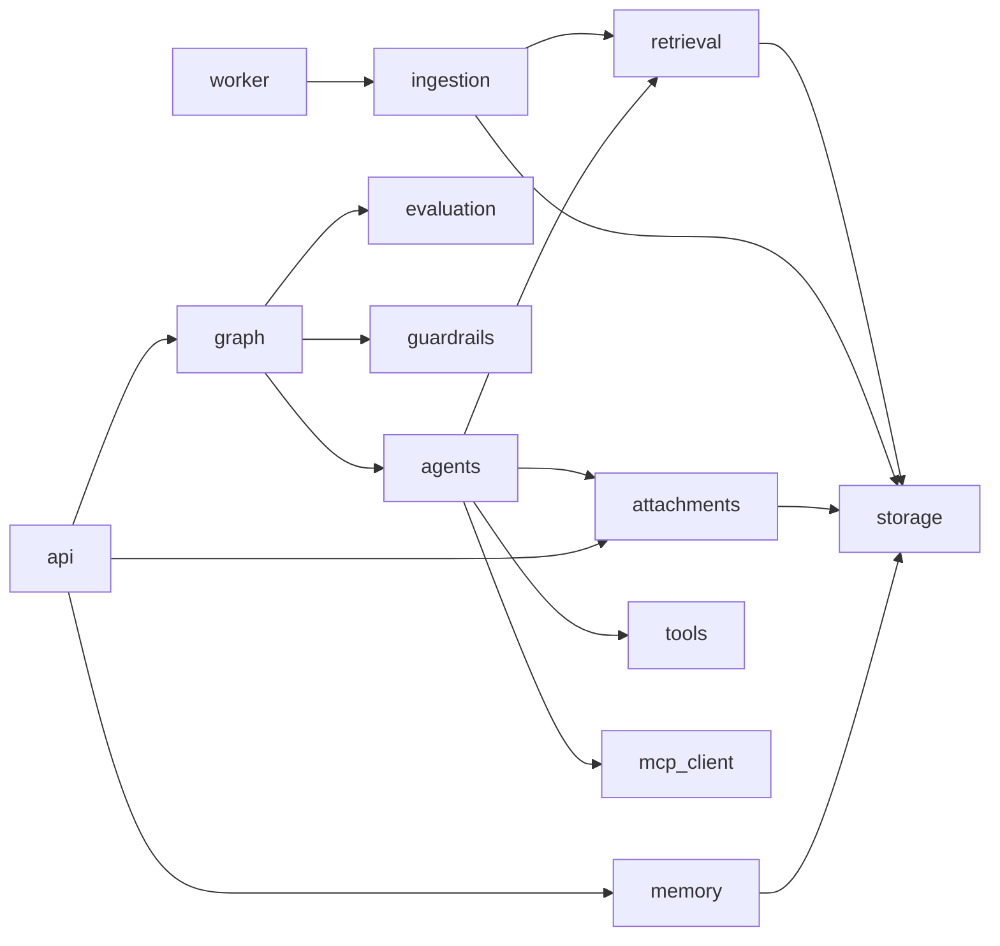

# src/

Mã nguồn lõi, không phụ thuộc HTTP. [api/](../api/README.md) và worker cùng dùng các module này.

## Thư mục con

| Thư mục | Chức năng |
| :-- | :-- |
| [graph/](graph/README.md) | Đồ thị LangGraph: các bước và điều kiện rẽ nhánh |
| [agents/](agents/README.md) | Các agent |
| [retrieval/](retrieval/README.md) | Tìm kiếm vector, BM25, mở rộng câu hỏi, rerank |
| [ingestion/](ingestion/README.md) | Nạp tài liệu vào kho vector |
| [attachments/](attachments/README.md) | Đọc và lưu tệp người dùng gửi |
| [tools/](tools/README.md) | Tìm kiếm web và đọc trang web |
| [mcp_client/](mcp_client/README.md) | Kết nối MCP server |
| [memory/](memory/README.md) | Lưu hội thoại, xử lý câu hỏi nối tiếp |
| [evaluation/](evaluation/README.md) | Chấm điểm, viết lại, đánh giá offline |
| [guardrails/](guardrails/README.md) | Chặn jailbreak, chống prompt injection, che dữ liệu cá nhân |
| [auth/](auth/README.md) | Tài khoản và phiên đăng nhập |
| [storage/](storage/README.md) | Database, kho tài liệu, hàng đợi |
| [observability/](observability/README.md) | Metric, log, tracing (tracing chưa dùng) |
| [utils/](utils/README.md) | Logger và đo thời gian |

## File ở cấp này

| File | Chức năng |
| :-- | :-- |
| [runtime.py](runtime.py) | `RunContext` của mỗi câu hỏi: cờ hủy, đếm token, chủ sở hữu. Truyền qua config của LangGraph |
| [worker.py](worker.py) | Xử lý job nạp tài liệu và theo dõi `data/raw`. Chạy riêng bằng `python -m src.worker`, hoặc trong một luồng của API |
| [\_\_init\_\_.py](__init__.py) | Export nạp lười: import module nhẹ không kéo theo mô hình |

## Gọi trực tiếp từ Python

```python
from src.graph import run_workflow

result = run_workflow("Luật việt vị là gì?")
print(result["final_answer"], result["sources"])
```

## Quan hệ giữa các module


