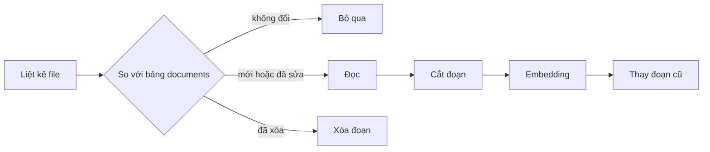

# src/ingestion/

Đồng bộ kho tài liệu `data/raw` với kho vector.

## Các file

| File | Chức năng |
| :-- | :-- |
| [auto_ingest.py](auto_ingest.py) | `sync_documents()`: so kho với bảng `documents`, nạp phần thay đổi. Hàm tra cứu tài liệu cho API |
| [chunker.py](chunker.py) | `DocumentChunker`: cắt đoạn theo ký tự |
| [contextualizer.py](contextualizer.py) | Đang tắt (`CONTEXTUAL_CHUNKS`): gắn tiêu đề, mục và tóm tắt trang vào đầu đoạn |

## Quy trình

- **Định dạng:** `.pdf`, `.txt`, `.md`, `.docx`. PDF scan **không** được nhận dạng chữ ở đây (khác với tệp đính kèm trong chat).
- **Nhận biết thay đổi:** dung lượng và thời gian sửa. Nhánh S3 (ETag) mới thử với S3 giả lập.
- **Khi chạy:** lúc khởi động, sau khi tải lên hoặc xóa, khi thư mục thay đổi, hoặc gọi `POST /api/ingest/sync`.
- **Trạng thái:** `pending`, `indexing`, `ready`, `failed`. File lỗi không được thử lại cho tới khi thay đổi.
- **Khóa:** mỗi lúc chỉ một lần đồng bộ; với Postgres khóa có hiệu lực giữa các tiến trình.
