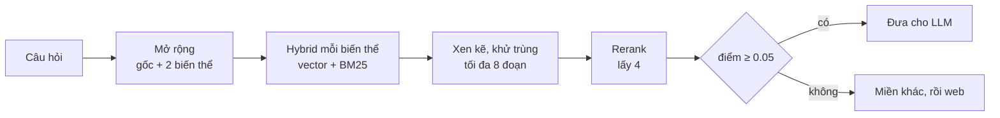

# src/retrieval/

Tìm các đoạn tài liệu liên quan tới câu hỏi.

## Các file

| File | Chức năng |
| :-- | :-- |
| [vector_store.py](vector_store.py) | `VectorStoreManager`: tìm vector, BM25, hybrid. Hai backend: `ChromaBackend`, `PgVectorBackend` |
| [query_expansion.py](query_expansion.py) | `QueryExpander`: multi-query (đang dùng); HyDE, từ đồng nghĩa, theo miền không được gọi tới |
| [reranker.py](reranker.py) | `Reranker`: chấm lại bằng cross-encoder |
| [onnx_models.py](onnx_models.py) | Embedding và reranker trên ONNX Runtime int8 |
| [lang.py](lang.py) | Nhận diện tiếng Việt, chọn câu hỏi cùng ngôn ngữ với đoạn |

## Quy trình

## Điểm chính

- **Hybrid:** hợp nhất bằng Reciprocal Rank Fusion có trọng số.
- **Xuyên ngôn ngữ:** một biến thể là bản dịch Việt–Anh, và mỗi đoạn được rerank với câu hỏi cùng ngôn ngữ. Lý do: câu hỏi Việt với đoạn Anh chỉ được khoảng 0.02–0.05 điểm dù đoạn chứa đúng đáp án.
- **BM25** dựng trong bộ nhớ, tự dựng lại khi dữ liệu đổi, kể cả do worker khác.
- **pgvector:** thay toàn bộ đoạn của một file trong một transaction. Cần pgvector 0.8 trở lên (dùng `hnsw.iterative_scan`).
- **Tên index** gồm mô hình, runtime và phiên bản. Đổi một trong ba thì tài liệu được nạp lại vào index mới, index cũ vẫn còn.
- **Nạp lười:** mô hình chỉ nạp ở lần dùng đầu, hoặc khi API khởi động.
